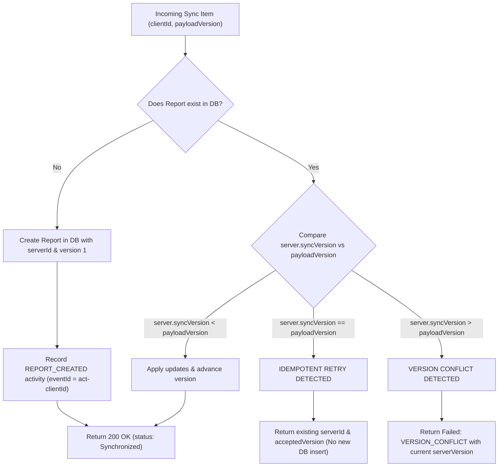

# Offline Synchronization Strategy & Conflict Resolution

## 1. Synchronization Challenge & Overview

In intermittent and zero-connectivity environments, field workers capture reports locally on their devices. When connectivity is restored, the client must synchronize accumulated records with the central backend.

The synchronization strategy must overcome several distributed systems failure modes:
1. **Network dropouts during transmission**: The client sends a batch, the server writes it to MongoDB, but the cellular tower drops before the HTTP `200 OK` response reaches the client.
2. **Duplicate submissions**: The client retries the same report batch repeatedly until an acknowledgment is received.
3. **Version conflicts**: A coordinator triages or reassigns an issue online while a field worker makes an offline edit to the same issue.
4. **Partial batch failures**: One item in a batch contains an unprocessable validation error, but other valid items must not be aborted.
5. **Activity history duplication**: Retrying a sync batch must not duplicate timeline activity events.

---

## 2. Idempotency Architecture (`clientId`)

Every field report generated on the client has a crypto-random UUID v4 assigned at creation time (`clientId`).

### Invariant
The backend database enforces a strict unique index on `clientId`:
```javascript
reportSchema.index({ clientId: 1 }, { unique: true });
```

### Server Ingestion Logic (`server/src/services/syncService.js`)
When an operation (`CREATE_REPORT`) arrives at `POST /api/reports/sync`:



1. **New Report**: Created atomically with initial `REPORT_CREATED` activity.
2. **Idempotent Retry**: If the existing document in MongoDB has `syncVersion === payloadVersion`, the server recognizes that the previous response was dropped in transit. It returns `status: "Synchronized"` with the already-assigned `serverId` without creating a duplicate record or a duplicate creation activity.
3. **Stale Version Conflict**: If the server has already progressed to a higher `syncVersion` (e.g. coordinator assigned it), the server rejects the update with error code `VERSION_CONFLICT` and reports the latest server version so the client can resolve it.

---

## 3. Batch Synchronization & Partial Success

Field workers may have multiple queued operations when reconnecting. The endpoint `POST /api/reports/sync` accepts up to 50 items.

### Independent Per-Item Processing
Each item in the batch is processed independently:
- If Item 1 succeeds, it commits to MongoDB.
- If Item 2 has a validation error or conflict, it fails with error details.
- If Item 3 succeeds, it commits to MongoDB.

### Contract Format
```json
{
  "syncedAt": "2026-11-12T20:30:00.000Z",
  "processedCount": 3,
  "successCount": 2,
  "failedCount": 1,
  "results": [
    {
      "clientId": "f47ac10b-58cc-4372-a567-0e02b2c3d401",
      "serverId": "SRV-2026-D401",
      "acceptedVersion": 1,
      "status": "Synchronized",
      "syncedAt": "2026-11-12T20:30:00.000Z"
    },
    {
      "clientId": "f47ac10b-58cc-4372-a567-0e02b2c3d402",
      "status": "Failed",
      "error": {
        "code": "VERSION_CONFLICT",
        "message": "Server already has a newer version (3) than payload (1).",
        "serverVersion": 3,
        "clientVersion": 1
      }
    },
    {
      "clientId": "f47ac10b-58cc-4372-a567-0e02b2c3d403",
      "serverId": "SRV-2026-D403",
      "acceptedVersion": 1,
      "status": "Synchronized",
      "syncedAt": "2026-11-12T20:30:00.000Z"
    }
  ]
}
```

The client keeps Item 2 safely in IndexedDB for retry or conflict review, while marking Items 1 and 3 as `Synchronized`.

---

## 4. Multi-Document Transactions & Atomicity

In high-concurrency environments, a report must not be created without its corresponding audit log (`Activity`).

The backend uses MongoDB Multi-Document Transactions:
```javascript
export async function withTransaction(work) {
  const session = await mongoose.startSession();
  try {
    let result;
    await session.withTransaction(async () => {
      result = await work(session);
    });
    return result;
  } finally {
    await session.endSession();
  }
}
```

- When MongoDB is running with replica sets, both the `Report` document and its initial `Activity` event commit together atomically.
- If MongoDB is running in standalone mode (without replica set enabled), the sync service detects this and falls back to ordered non-transactional execution without crashing.

---

## 5. Standard Error Codes for Sync Engine

| Error Code | HTTP Status | Meaning | Client Action |
| :--- | :--- | :--- | :--- |
| `VALIDATION_ERROR` | 400 | Report payload has invalid fields (e.g. description too short) | Keep in IndexedDB, alert user to edit and fix required fields |
| `VERSION_CONFLICT` | 409 / 200 (in batch) | Server has a higher `syncVersion` than the queued update | Refresh report from server; merge or review changes |
| `DUPLICATE_CLIENT_ID` | 409 | Attempting to create a different report with an existing UUID | Regenerate UUID if legitimately different, or reconcile |
| `INVALID_TRANSITION` | 422 | Attempted workflow transition violates state machine | Block transition; revert local status to server status |
| `UNAUTHORIZED_ROLE` | 403 | User role lacks permission for this operation (e.g. assign) | Prompt user to switch to Coordinator or request triage |
| `RATE_LIMIT_EXCEEDED`| 429 | Too many requests in short interval | Apply exponential backoff before retrying |

